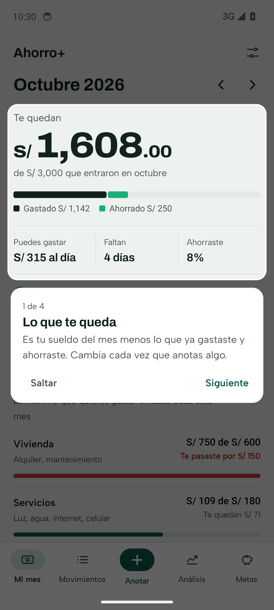
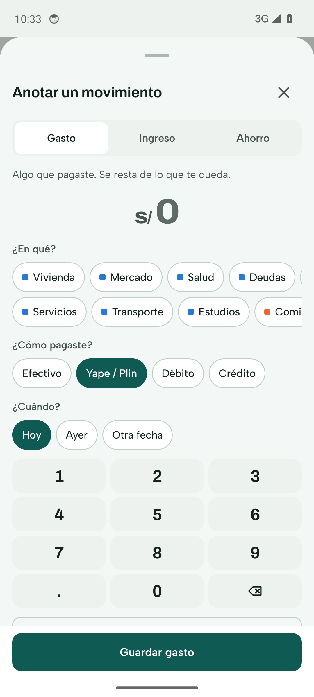
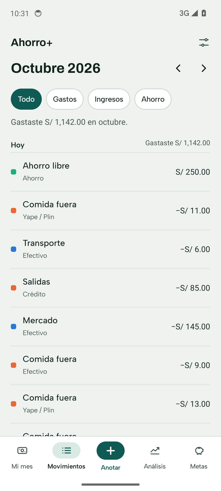
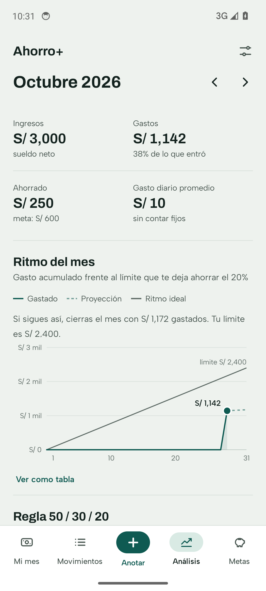

# Ahorro+

App de Android para llevar el sueldo, los gastos y el ahorro del mes, en soles. Se anota cada gasto (hasta el menú de S/ 12) en segundos, y la app muestra a dónde se va la plata y sugiere qué cambiar.

**Sin internet, sin cuentas, sin publicidad.** Todo queda en el celular.

<p>
  
  
  
  
</p>

## Qué hace

- **Mi mes**: lo que te queda del mes, cuánto puedes gastar por día y los días que faltan. Debajo, los **límites por categoría**: lo máximo que quieres gastar en cada cosa. La barra se pone ámbar cuando te acercas y roja si te pasas.
- **Anotar** (el botón del centro): cada vez que gastas, recibes plata o ahorras, lo anotas en el momento con un teclado propio. Pones el monto, eliges en qué fue y listo. También guarda cómo pagaste: efectivo, Yape/Plin, débito o crédito.
- **Movimientos**: todo lo anotado en el mes, por día. Al tocar uno se puede editar o borrar.
- **Tutorial** de cuatro pasos la primera vez. Se puede volver a ver desde Ajustes.
- **Análisis**:
  - Ritmo de gasto contra el límite que te deja ahorrar, con la proyección a fin de mes.
  - Regla 50/30/20.
  - Gasto por categoría contra su límite y contra el mes anterior.
  - Medios de pago.
- **Recomendaciones**: se calculan en el celular. Detectan:
  - Ritmo de gasto excesivo.
  - Categorías que pasaron su límite o van camino a pasarlo.
  - Gastos hormiga.
  - Falta de ahorro.
  - Uso alto de la tarjeta de crédito.
  - Ausencia de un fondo de emergencia.

  Cada una dice cuánto se podría ahorrar.
- **Metas de ahorro**: para qué estás juntando plata y cuánto apartar al mes para llegar a la fecha.
- **Ajustes**: sueldo neto, día de pago, % de ahorro, límites por categoría, bloqueo con huella y respaldo cifrado.

## Instalar

1. En [Releases](../../releases) descarga `ahorro-mas-vX.Y.Z.apk` y su `.sha256`.
2. Verifica el archivo: `sha256sum -c ahorro-mas-vX.Y.Z.apk.sha256`.
3. En el celular, permite instalar apps de esa fuente cuando Android lo pida, y abre el APK.

Requiere Android 8.0 o superior.

> El certificado de firma de las versiones oficiales tiene este SHA-256:
> `f0:20:70:32:07:ff:0b:9e:be:c9:25:30:ce:7d:70:20:a2:e4:ab:1c:a4:fc:ed:db:fc:66:32:df:a9:6d:ee:03`.
> Puedes revisarlo con `apksigner verify --print-certs`.

## Proyecto

- [Hoja de ruta](ROADMAP.md): qué viene en cada versión y con qué criterios se publica.
- [Cambios](CHANGELOG.md) de cada versión.
- [Proceso de desarrollo](docs/proceso.md): cómo se planifica, desarrolla y publica.
- [Decisiones](docs/decisiones.md) tomadas y su porqué.
- ¿Algo falla o tienes una idea? Abre un [issue](../../issues/new/choose).

Ahorro+ es gratis y sin anuncios.

## Seguridad

Ver [SEGURIDAD.md](SEGURIDAD.md). En corto:
- No tiene permiso de internet.
- No exporta componentes.
- No hace copias a la nube.
- Tiene bloqueo opcional con huella.
- Oculta el contenido en "recientes".
- El respaldo se cifra con AES-256-GCM.
- Todas las dependencias se verifican por SHA-256.

## Compilar

Requisitos: JDK 17 y Android SDK 34.

```bash
./gradlew :app:testDebugUnitTest      # tests
./gradlew :app:assembleDebug          # APK de prueba (pe.sencillo.app.debug)
./gradlew :app:assembleRelease        # APK firmado
```

`assembleRelease` busca la clave de firma así:
1. Primero en las variables `SENCILLO_KEYSTORE`, `SENCILLO_KEYSTORE_CLAVE`, `SENCILLO_KEY_ALIAS` y `SENCILLO_KEY_CLAVE`.
2. Si no están, en `~/.sencillo/keystore.properties`.

Si no encuentra ninguna, genera un APK sin firmar. **Guarda una copia de la clave fuera de la PC**: si se pierde, las actualizaciones no se pueden instalar encima de la versión anterior.

### Publicar una versión desde GitHub

1. Carga la clave como secreto, una sola vez:
   ```bash
   base64 -w0 ~/.sencillo/sencillo-release.jks | gh secret set SENCILLO_KEYSTORE_B64
   gh secret set SENCILLO_KEYSTORE_CLAVE      # pega la clave de ~/.sencillo/keystore.properties
   ```
2. Sube `versionCode` y `versionName` en `app/build.gradle.kts`, crea la etiqueta y súbela:
   ```bash
   git tag v0.1.0 && git push origin v0.1.0
   ```
   El workflow corre los tests, compila, firma y publica el APK con su SHA-256 en Releases.

## Estructura

```
app/src/main/java/pe/sencillo/
  datos/       Room: movimientos, perfil, límites por categoría (tabla `sobres`), metas; dinero en céntimos
  dominio/     catálogo, análisis del mes y recomendaciones (Kotlin puro, con tests)
  seguridad/   bloqueo biométrico, cifrado y validación del respaldo
  ingesta/     punto de entrada para integraciones (ver INTEGRACIONES.md)
  ui/          Jetpack Compose: pantallas, tema y componentes
prototipo/     primer prototipo web (HTML), solo como referencia de diseño
```

Stack:
- Kotlin 2.0.0
- Jetpack Compose (BOM 2024.06.00)
- Room 2.6.1
- androidx.biometric 1.1.0
- AGP 8.5.2
- Gradle 8.9

El proyecto empezó como "Sencillo". Los nombres internos se mantienen: paquete `pe.sencillo.app`, clases, variables `SENCILLO_*` de firma y carpeta `~/.sencillo`. Cambiar el id del paquete haría que Android trate la app como otra distinta y no se podría actualizar encima de la instalada.

Las fuentes Archivo, Albert Sans e IBM Plex Mono van dentro de la app con licencia SIL OFL 1.1 (ver `licencias/`).
